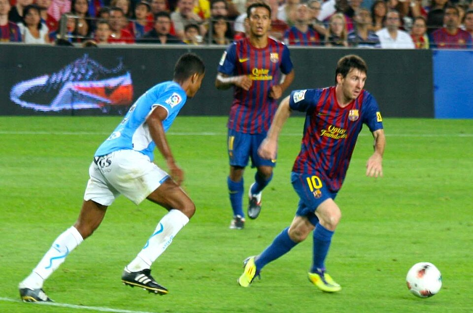

[← Volver al inicio](README.md)
# Temas del curso

### 16/09 · Mis aficiones

Llevo jugando al futbol desde los 5 años, en el equipo
del pueblo. Lo que más me gusta no es marcar, es el momento
en que sale una jugada que habíamos entrenado veinte veces
y por fin sale. Entreno martes miércoles y jueves, y los sábados hay
partido. También llevo un año yendo al gimnasio, aunque
ahí voy mucho más lento: no se ven los resultados tan rapido.

Buscando en GitHub he encontrado [gimnasio](https://github.com/pacohunterdev/sistema-gimnasio)

---

### 23/10 Premios Princesa: Leo Messi
He elegido a Leo Messi ya que me gusta el deporte y su estilo de juego, además me parece un gran ejemplo de superación a nivel personal.

[enlace](https://www.fpa.es/es/premios-princesa-de-asturias/premiados/2026-leo-messi/)

Leo Messi es un futbolista argentino que ha ganado el Premio Princesa de Asturias de los Deportes 2026. Se lo han dado por todo lo que ha conseguido en el fútbol y por ser un ejemplo para muchas personas. He elegido a Messi porque me gusta el fútbol y me parece impresionante cómo juega. También admiro todo el esfuerzo que ha hecho para llegar a ser uno de los mejores futbolistas del mundo.

En esta imagen se encuentra regateando Messi a otro jugador.

